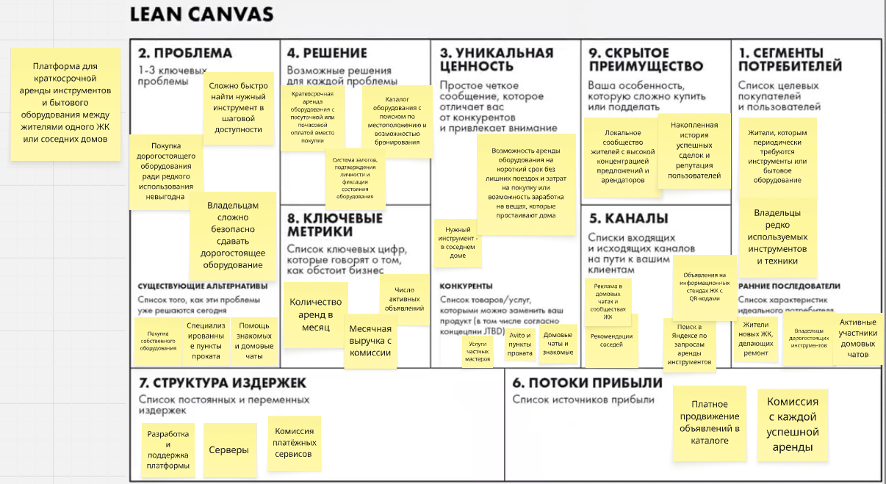

# Платформа для аренды

Платформа для краткосрочной аренды инструментов и бытового оборудования между жителями одного ЖК или соседних домов.

## Elevator Pitch

Представьте, что вам нужно повесить полку или почистить диван моющим пылесосом. Покупать дорогостоящее оборудование ради одного использования невыгодно, а ехать в специализированный пункт проката неудобно. При этом нужный инструмент вполне может находиться у вашего соседа и большую часть времени лежать без дела.

Мы предлагаем онлайн-платформу для краткосрочной аренды инструментов и бытового оборудования между жителями одного жилого комплекса или соседних домов.

Наш сервис позволит находить необходимое оборудование в шаговой доступности, бронировать его и оплачивать аренду онлайн. Арендаторы смогут экономить время и деньги, а владельцы — получать дополнительный доход от своих вещей. Для снижения рисков мы предусмотрели систему залогов, подтверждения личности и фиксации состояния оборудования.

В основе бизнес-модели лежит комиссия с каждой успешной аренды. Мы планируем начать с пилотного запуска в нескольких жилых комплексах, сформировать локальное сообщество пользователей и в дальнейшем масштабировать платформу на другие районы.

Мы ищем партнёров для организации пилотного запуска и проверки востребованности сервиса. Готовы ли вы обсудить возможность участия в таком проекте?

## Lean Canvas

