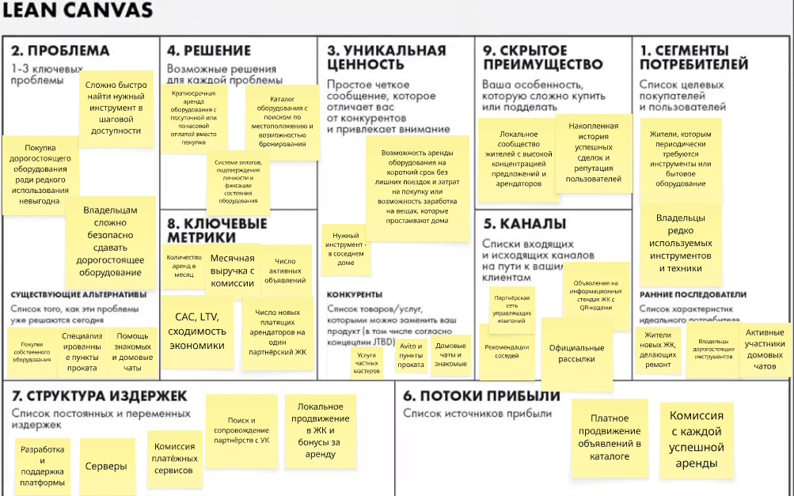

# Домашнее задание №2 

## 1. Ключевые гипотезы и HADI

### Гипотеза №1
Если предоставить владельцам инструментов и бытового оборудования возможность сдавать их соседям за вознаграждение с использованием залога и фиксации состояния вещей, то не менее 30% опрошенных владельцев согласятся разместить своё оборудование для реальной аренды.
Проверяемый риск: Value Risk — риск того, что владельцы не захотят предоставлять своё имущество незнакомым людям из-за опасений повреждения или кражи.

### Гипотеза №2. Спрос на краткосрочную аренду
Если жители ЖК смогут арендовать необходимые инструменты и бытовое оборудование в шаговой доступности по цене существенно ниже стоимости покупки, то не менее 25% жителей, испытывающих такую потребность в ближайший месяц, оформят заявку на аренду.
Проверяемый риск: Value Risk — риск отсутствия достаточного спроса на краткосрочную аренду оборудования между соседями.

### Проверка основной гипотезы (HADI)
Главная гипотеза - гипотеза №1, потому что наличие спроса не обеспечивает наличие предложения, из-за этого можно набрать базу желающих взять оборудование в аренду, но не найти арендодателей

HADI — проверка гипотезы №1
H
Не менее 30% владельцев редко используемых инструментов и бытового оборудования согласятся разместить их для реальной аренды соседям при наличии залога и процедуры фиксации состояния имущества.
A 
Провести эксперимент без разработки приложения:
Найти 30 владельцев инструментов и бытового оборудования среди жителей нескольких ЖК.
Представить им концепцию сервиса и условия аренды, включая предполагаемую систему залогов и ответственность сторон.
Предложить разместить реальное объявление через простую Google-форму или в специально созданном Telegram-чате.
Собрать фотографии, описание, стоимость и доступные даты аренды оборудования.
Составить каталог предложений вручную и при наличии заинтересованных арендаторов помочь сторонам договориться о пробной аренде.
D 
В течение двух недель собрать следующие показатели:
Количество владельцев, которым предложено участие.
Количество согласившихся разместить реальные объявления.
Количество опубликованных предложений.
Причины отказов владельцев.
I 
Гипотеза получит предварительное подтверждение, если не менее 9 из 30 владельцев предоставят реальные объявления с фотографиями, ценами и доступными датами аренды.
Если показатель окажется ниже 30%, необходимо проанализировать причины отказов и пересмотреть механизмы обеспечения безопасности либо условия аренды.

## 2. Юнит-экономика

### Расчёт CAC
пусть рекламный бюджет на месяц - 15000р
реклама в яндекс директе
500р посетителей сайта за месяц
стоимость одного перехода - 30р
100 регистраций - 20% от посетителей
10 платящих арендаторов - 10% от зарегестрированных
общая конверсия посетителя в платящего клиента - 10/500 = 2%
тогда CAC = 15000/10 = 1500р

пусть комиссия от аренды - 15%
средняя стоимость аренды оборудования - 900р
900*0,15 = 135р
пусть 35р уходят на прочие расходы на сделку (обработка платежей и тд)
тогда маржинальный доход платформы - 100р

### Расчёт LTV
пусть пользователь арендует оборудование 3 раза в год
продолжительность пользования сервисом - 2 года
тогда будет 6 аренд, а значит 6*100 = 600р с каждого пользователя

### Проверка сходимости экономики
LTV/CAC = 600/1500 = 0,4 - платформа не окупается, юнит-экономика не сходится

Решения: снизить CAC, увеличить комиссию, увеличить средний чек, добиться большей частоты повторных аренд

Самое логичное - снизить CAC

## 3. Channel Pivot

### Описание пивота
Channel Pivot - изменение основного канала привлечения клиентов. Вместо продвижения платформы через платную интернет-рекламу переход к взаимодействию к управляющим компаниям ЖК. Это позволит запустить проект сразу в некоторых ЖК, благодаря чему будет сформирована база пользователей, находящихся рядом.

### Пересчёт юнит-экономики
условный бюджет на рекламу должен уменьшиться, пусть это будет 12000р
если получится получить 20 платящих пользователей с одного ЖК при тестовом запуске в трёх ЖК, то будет получено 60 платящих пользователей
CAC = 12000/60 = 200р
при неизменном LTV = 600р 
LTV/CAC = 600/200 = 3

### Обновлённый Lean Canvas
Изменения в LEAN CANVAS:
блок 5: попытка охватить всё не самостоятельно рекламой, а централизованным запуском
блок 7
блок 8

