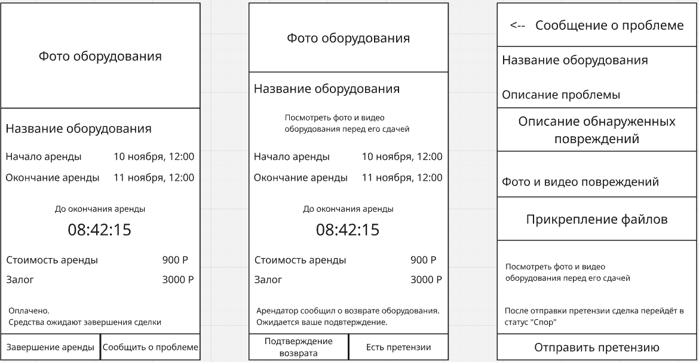

## 1. DDD — доменные зоны

Платформа разделена на пять доменных зон.

### 1.1. Пользователи и учётные записи

Отвечает за регистрацию, авторизацию, хранение профилей пользователей, их расположения и подтверждение личности.

**Глоссарий:**

- Пользователь — зарегистрированный участник платформы.
- Учётная запись — данные пользователя для входа и работы с сервисом.
- Роль — арендатор или арендодатель; один пользователь может выполнять обе роли.
- Верификация — подтверждение личности пользователя.

### 1.2. Каталог оборудования

Отвечает за размещение, хранение и поиск объявлений об аренде оборудования, его описание, фотографии, стоимость и предлагаемые даты доступности.

**Глоссарий:**

- Оборудование — инструмент или бытовая техника, предлагаемая в аренду.
- Объявление — предложение владельца о сдаче оборудования.
- Арендодатель — пользователь, предоставляющий оборудование в аренду.
- Стоимость аренды — установленная владельцем цена использования оборудования.
- Доступность — периоды, в которые владелец готов сдавать оборудование.

### 1.3. Бронирование и аренда

Отвечает за создание и подтверждение заявок, резервирование оборудования, контроль пересечения дат, передачу и возврат оборудования.

**Глоссарий:**

- Арендатор — пользователь, получающий оборудование во временное пользование.
- Заявка — запрос на аренду оборудования в выбранный период.
- Бронирование — согласованное владельцем резервирование оборудования.
- Период аренды — даты начала и окончания аренды.
- Сделка аренды — процесс предоставления оборудования, включающий оплату, передачу и возврат.
- Статус аренды — текущее состояние сделки.

### 1.4. Платежи и залоги

Отвечает за оплату аренды, учёт залогов, расчёт комиссии платформы, выплаты арендодателям и возврат денежных средств.

**Глоссарий:**

- Платёж — денежная операция, связанная с арендой.
- Залог — денежное обеспечение выполнения условий аренды.
- Комиссия платформы — 15% от стоимости аренды.
- Выплата — сумма, перечисляемая арендодателю.
- Возврат залога — возвращение или освобождение залоговых средств после выполнения условий сделки.

### 1.5. Модерация и разрешение споров

Отвечает за проверку объявлений, обработку жалоб и рассмотрение разногласий между участниками аренды.

**Глоссарий:**

- Модерация — проверка объявлений на соответствие правилам платформы.
- Жалоба — обращение пользователя о нарушении или проблеме.
- Спор — разногласие между участниками сделки.
- Доказательства — фотографии и другие материалы для рассмотрения спора.
- Администратор — представитель платформы, рассматривающий обращения и нарушения.


## 2. BDD — критический путь MVP

**Критический путь:** завершение аренды и распределение денежных средств после возврата оборудования.

### 2.1. Сценарий успеха

**Дано:** оборудование возвращено владельцу, аренда оплачена, залог внесён, претензий нет.

**Когда:** оба участника подтверждают успешный возврат оборудования.

**Тогда:** платформа инициирует выплату арендодателю за вычетом комиссии 15% и возврат залога арендатору. После подтверждения денежных операций сделка получает статус «Завершена».

### 2.2. Сценарий отказа

**Дано:** оборудование возвращено, но арендодатель обнаружил предполагаемые повреждения.

**Когда:** арендодатель сообщает о претензии через платформу.

**Тогда:** сделка переходит в статус «Спор», распределение денежных средств приостанавливается, обращение направляется администратору для рассмотрения.

## 3. Wireframes — экраны мобильного приложения

Разработаны три схематичных экрана мобильного приложения.

### 3.1. Экран текущей аренды

Отображает фотографию и название оборудования, даты начала и окончания аренды, таймер оставшегося времени, стоимость аренды и сумму залога.

Арендатор может подтвердить возврат оборудования или сообщить о проблеме, возникшей во время аренды. После подтверждения возврата появляется сообщение об ожидании подтверждения от арендодателя.

### 3.2. Экран подтверждения возврата

Предназначен для арендодателя. Содержит информацию об оборудовании и аренде, а также возможность просмотра фотографий и видео, сделанных до передачи оборудования.

Арендодатель может выбрать одно из двух действий: «Подтвердить возврат» или «Есть претензии».

### 3.3. Экран оформления претензии

Открывается, когда арендатор или арендодатель сообщает о неисправности или повреждении оборудования.

Пользователь может описать проблему, приложить фотографии или видео и отправить обращение на рассмотрение администрации платформы.

### Схемы экранов



## 4. API-first — JSON-контракты

Спроектированы две API-ручки: подтверждение возврата оборудования и создание претензии.

### 4.1. Подтверждение возврата оборудования

**Метод:** `POST`

**Адрес:** `/api/rentals/{id}/confirm-return`

**Назначение:** подтверждение возврата оборудования одним из участников аренды.

**JSON-запрос:**

```json
{
  "condition": "no_claims"
}
```

Поле `condition` указывает на отсутствие претензий. Идентификатор аренды передаётся в адресе запроса, а пользователь определяется сервером по токену авторизации.

**Успешный ответ (200 OK):**

```json
{
  "rental_id": 42,
  "status": "waiting_for_owner",
  "message": "Ожидается подтверждение арендодателя"
}
```

Пример показывает результат подтверждения со стороны арендатора. После подтверждения обеими сторонами статус меняется на `pending_settlement` — ожидание денежных расчётов. После успешных выплат сделка завершается.

**Ошибка (403 Forbidden):**

```json
{
  "error": "ACCESS_DENIED",
  "message": "У вас нет прав для подтверждения этой аренды"
}
```

### 4.2. Создание претензии

**Метод:** `POST`

**Адрес:** `/api/rentals/{id}/disputes`

**Назначение:** регистрация обращения арендатора или арендодателя при обнаружении неисправности или повреждения оборудования.

**JSON-запрос:**

```json
{
  "description": "После возврата перфоратор не включается",
  "evidence_ids": [
    "photo_101",
    "video_102"
  ]
}
```

Поле `description` содержит описание проблемы, а `evidence_ids` — идентификаторы предварительно загруженных фотографий и видеозаписей.

**Успешный ответ (201 Created):**

```json
{
  "dispute_id": 7,
  "rental_id": 42,
  "status": "disputed",
  "settlement_status": "paused",
  "message": "Претензия отправлена на модерацию"
}
```

После создания обращения сделка переходит в статус «Спор», денежные расчёты приостанавливаются до разрешения ситуации.

**Ошибка (409 Conflict):**

```json
{
  "error": "DISPUTE_ALREADY_EXISTS",
  "message": "По данной аренде уже открыт спор"
}
```

