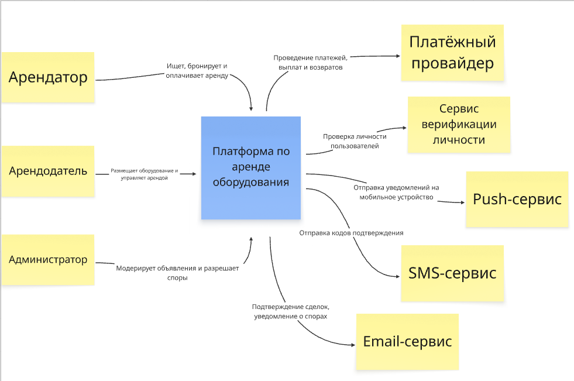
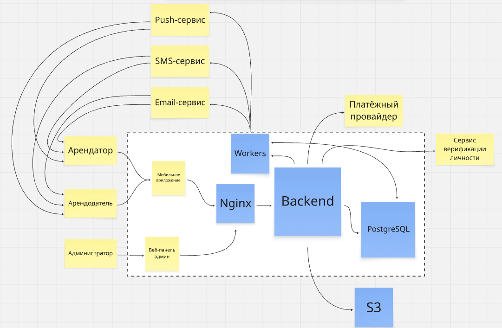

# ДЗ №5. Архитектура приложения «ПоСоседству»

## 1. C4 — уровень 1 (Context)

Основные участники системы:

- **Арендатор** — ищет, бронирует и оплачивает аренду оборудования.
- **Арендодатель** — размещает объявления и управляет арендой.
- **Администратор** — модерирует объявления и рассматривает споры.

Внешние системы:

- **Платёжный провайдер** — обработка платежей, залогов, выплат и возвратов.
- **Сервис верификации личности** — проверка личности пользователей.
- **Push-сервис** — отправка уведомлений на мобильные устройства.
- **SMS-сервис** — отправка кодов подтверждения.
- **Email-сервис** — отправка писем о сделках и спорах.

### Диаграмма C1

## 2. C4 — уровень 2 (Containers)

Основные функции объединены в одном Backend, но логически разделены на модули: пользователи, каталог оборудования, бронирование и аренда, платежи и залоги, модерация и споры.

Основные элементы архитектуры:

- **Мобильное приложение** — интерфейс арендатора и арендодателя.
- **Веб-панель администратора** — интерфейс для модерации объявлений и рассмотрения споров.
- **Nginx** — принимает HTTPS-запросы и перенаправляет их в Backend.
- **Backend** — реализует бизнес-логику, предоставляет API и взаимодействует с внешними сервисами.
- **PostgreSQL** — хранит пользователей, объявления, бронирования, платежи и споры.
- **Workers** — выполняют фоновые задачи, включая отправку уведомлений и обработку неоплаченных бронирований.

Для хранения фотографий и видео оборудования используется внешнее S3-совместимое хранилище.

Мобильное приложение взаимодействует с Backend через API по HTTPS с передачей данных в формате JSON. Административный веб-интерфейс обслуживается Django. Для фоновых задач используется PostgreSQL без отдельного брокера сообщений.

### Диаграмма C2

## 3. Выбор и обоснование технологического стека MVP

### 3.1. Мобильное приложение — Dart и Flutter

Основная причина выбора — возможность использовать единую кодовую базу для Android и iOS, что упрощает разработку и дальнейшее сопровождения двух версий приложения.

В отличие от разработки на Kotlin и Swift, нам не потребуется создавать два отдельных интерфейса. По сравнению с Kotlin Multiplatform, Flutter предоставляет единый набор инструментов для разработки интерфейсов на обеих платформах. 

### 3.2. Backend — Python, Django и Django REST Framework

Для серверной части выбран Python с фреймворком Django и расширением Django REST Framework.

В отличие от разработки Backend на Go или C++, Python позволяет быстрее реализовывать типовую бизнес-логику благодаря простому синтаксису и большому количеству готовых библиотек. Для MVP скорость разработки важнее максимальной вычислительной производительности, поскольку основная нагрузка связана с запросами к базе данных, бронированиями и взаимодействием с внешними сервисами.

Django выбран вместо более минималистичных фреймворков, например FastAPI, поскольку предоставляет готовые механизмы авторизации, работы с базой данных и административный интерфейс. Это сокращает количество функциональности, которую пришлось бы разрабатывать самостоятельно.

Django REST Framework позволяет реализовать API для мобильного приложения, включая созданные ранее операции подтверждения возврата оборудования и регистрации претензий.

### 3.3. Веб-панель администратора — Django Admin

Для административного интерфейса выбран Django Admin вместо отдельного приложения на React и TypeScript.

Создание самостоятельной веб-панели потребовало бы разработки дополнительного интерфейса и его сопровождения. Django Admin уже предоставляет средства просмотра, поиска и редактирования данных, а также управления доступом сотрудников.

### 3.4. Основная база данных — PostgreSQL

Приложение содержит большое количество связанных сущностей: пользователей, объявлений, бронирований, платежей и споров. Для их хранения подходит реляционная база данных, позволяющая устанавливать связи между таблицами и обеспечивать целостность информации.

### 3.5. Веб-сервер — Nginx

Использование Nginx позволяет отделить приём внешних HTTPS-запросов от выполнения бизнес-логики в Django. Nginx может управлять защищёнными соединениями, перенаправлять запросы к Backend и обслуживать статические файлы административного интерфейса.

### 3.6. Хранение фотографий и видео — S3

Хранение файлов непосредственно в PostgreSQL не выбрано, поскольку база данных в нашем проекте прежде всего предназначена для структурированной информации о пользователях, сделках и платежах.

В PostgreSQL будут сохраняться идентификаторы файлов и их связи с объявлениями или спорами, а сами фотографии и видео — в S3-хранилище.
